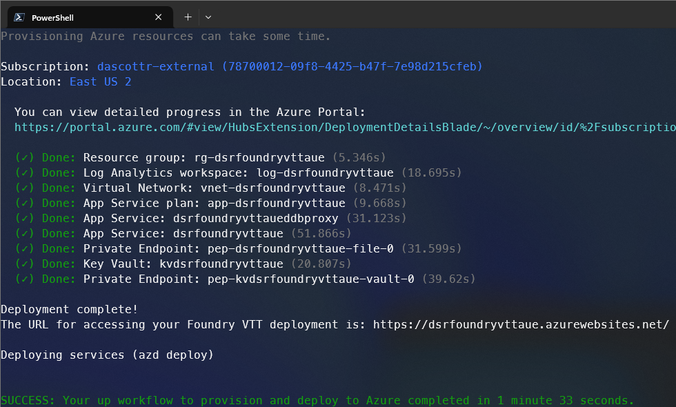
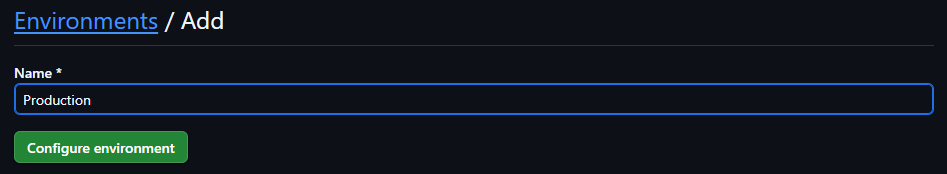
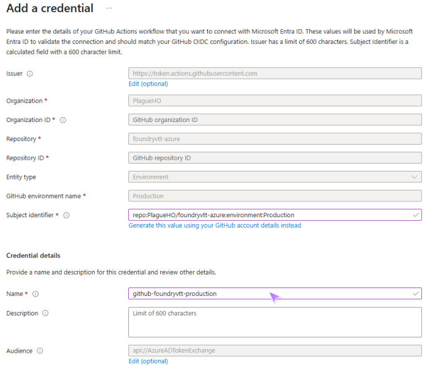
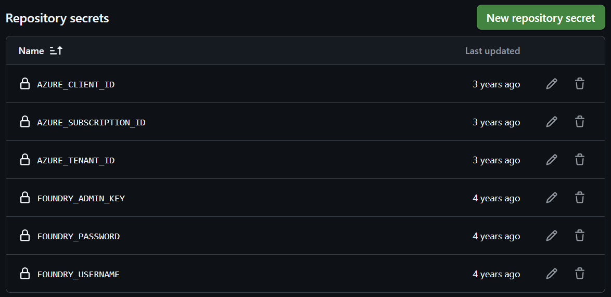
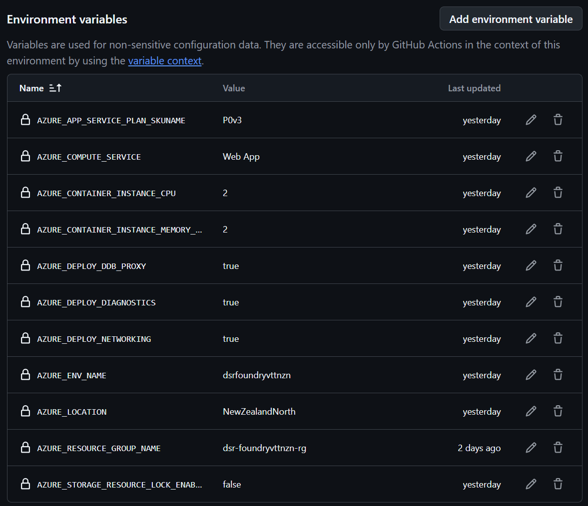
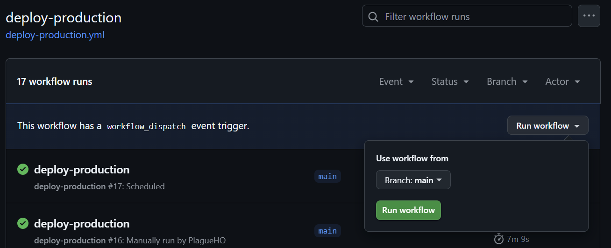
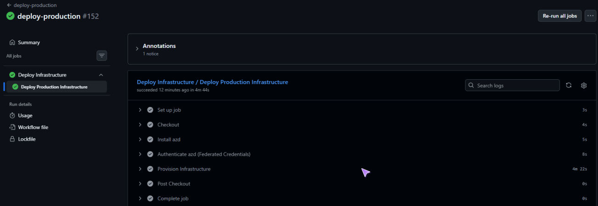

# FoundryVTT Azure Solution Accelerator

[![version][version-shield]][version-url]
[![Tests][ct-shield]][ct-url]
[![License][license-shield]][license-url]
[![Azure][azure-shield]][azure-url]
[![IaC][iac-shield]][iac-url]

Deploy your own [Foundry Virtual Table Top](https://foundryvtt.com/) server (with a valid license) to Azure using the [Azure Developer CLI (azd)](https://aka.ms/install-azd) and Bicep.

This solution accelerator provisions a secure, flexible, and updatable Foundry VTT environment in Azure, using best practices for security and well-architected Framework (WAF) where possible and sensible. Although WAF maybe considered overkill for a Foundry VTT deployment, it is included to demonstrate how to deploy a secure solution in Azure and most of it can be disabled using the configuration options if you prefer a simpler deployment.

> [!IMPORTANT]
> Due to the significant structural changes in v2.0.0, it is recommended to delete any previous deployments and start fresh with the latest version of this solution accelerator. This will ensure you have the most up-to-date features and configurations. You will need to take care to preserve any data you wish to keep, such as your Foundry VTT worlds, before deleting the existing deployment. You can back up your existing Foundry VTT data by copying the contents of the Azure Files share to a local machine or another storage account using tools like [Azure Storage Explorer](https://learn.microsoft.com/azure/storage/common/storage-explorer-install) or [AzCopy](https://learn.microsoft.com/azure/storage/common/storage-use-azcopy-v10). You can also deploy the new solution accelerator to a different resource group or Azure subscription and then copy the data across to the new deployment.
>
> If there is use for an upgrade guide to migrate existing deployments to the new structure, please open an issue on the [GitHub repository](https://github.com/PlagueHO/foundryvtt-azure/issues).

---

## Requirements

Before you begin, ensure you have:

1. An active Azure subscription ([Create a free account](https://azure.microsoft.com/free/)).
1. You will need `Contributor` and a role that can create Azure RBAC assignments on the Azure subscription you are deploying to, such as `Role Based Access Control Administrator`, `User Access Administrator`, or `Owner`.
1. If you use `User Access Administrator`, prefer a least-privilege condition that only allows assignment of `Key Vault Secrets Officer` and `Key Vault Secrets User` roles to service principals. This is sufficient for this solution because the deployment creates Azure Key Vault role assignments for the deployment principal and for managed identities used by Azure Web App or Azure Container Apps.
1. [Azure Developer CLI (azd)](https://aka.ms/install-azd) installed and updated.

---

## Key Features

- **Zero-trust**: Deploys resources into a virtual network with private endpoints and disables public access by default.
- **Azure Verified Modules**: Leverages [Azure Verified Modules](https://aka.ms/avm) for infrastructure.
- **Flexible compute**: Supports Azure Web App (Linux container), Azure Container Instance (lightweight), or future Azure Container Apps.
- **Persistent storage**: Uses Azure Files for Foundry VTT data.
- **Key Vault**: Uses Azure Key Vault to store storage account keys (and soon Foundry secrets).
- **Optional DDB-Proxy**: Deploy [DDB-Proxy](https://github.com/MrPrimate/ddb-proxy) for [DDB-Importer](https://github.com/MrPrimate/ddb-importer) plugin support.
- **Optional Bastion Host**: Deploy Azure Bastion for secure access.
- **Optional Diagnostics**: Deploy Azure Log Analytics and configure resource diagnostics.

---

## Compute Service Options

You can choose which Azure compute service to use for running Foundry VTT by setting the `AZURE_COMPUTE_SERVICE` environment variable before deployment. Supported options:

- **Web App** (default): Deploys Foundry VTT as a Linux container in Azure App Service. This option deploys into a virtual network by default. Recommended for most users.
- **Container Instance**: Deploys Foundry VTT in an Azure Container Instance. Useful for lightweight or temporary workloads. This option does not support deploying into a virtual network.
- **Container App**: Deploys Foundry VTT in Azure Container Apps with scale-to-zero support. Useful for cost-optimized deployments where the server is not always in use. Supports virtual network deployment.

Set the compute service using:

```sh
azd env set AZURE_COMPUTE_SERVICE "Web App" # or "Container Instance" or "Container App"
```

### Feature Comparison

| Feature                        | Web App (Default, Recommended)        | Container Instance                             | Container App                                   |
| ------------------------------ | ------------------------------------- | ---------------------------------------------- | ----------------------------------------------- |
| **Description**                | Azure App Service                     | Azure Container Instance                       | Azure Container Apps                            |
| **Docker Image**               | `felddy/foundryvtt:release`           | `felddy/foundryvtt:release`                    | `felddy/foundryvtt:release`                     |
| **Persistent Data**            | Azure Files                           | Azure Files                                    | Azure Files                                     |
| **Storage Account Access**     | Private VNET, Public Optional         | Public Only                                    | Private VNET, Public Optional                   |
| **DDB-Proxy Support**          | Yes (optional)                        | No                                             | Yes (optional)                                  |
| **DDB-Proxy Docker Image**     | `ghcr.io/mrprimate/ddb-proxy:release` | N/A                                            | `ghcr.io/mrprimate/ddb-proxy:latest`            |
| **Virtual Network Deployment** | Yes (default, enhances security)      | No                                             | Yes (default, enhances security)                |
| **Scale to Zero**              | No                                    | No                                             | Yes (default)                                   |
| **Current Status**             | Operational                           | Limited                                        | Operational                                     |
| **URL**                        | https://<env>.azurewebsites.net       | http://<env>.<region>.azurecontainer.io:30000/ | https://<env>.<region>.azurecontainerapps.io    |
| **Secrets Stored**             | Azure Key Vault                       | In service                                     | Azure Key Vault                                 |

---

## Deploying with Azure Developer CLI

### 1. Clone the repository

```sh
git clone https://github.com/PlagueHO/foundryvtt-azure.git
cd foundryvtt-azure
```

### 2. Authenticate with Azure

```sh
azd auth login
```

### 3. Configure environment variables

Set required and optional parameters using `azd env set`. For example:

```sh
azd env set FOUNDRY_USERNAME "<your-foundry-username>"
azd env set FOUNDRY_PASSWORD "<your-foundry-password>"
azd env set FOUNDRY_ADMIN_KEY "<your-foundry-admin-key>"
azd env set AZURE_ENV_NAME "myuniquefvtt"
azd env set AZURE_LOCATION "EastUS2"
```

> [!NOTE]
> After entering the first `azd env set` command, you will be prompted to **enter a name for your new environment**. This name will be used in resource names and URLs. It should be globally unique across Azure, so choose a name that reflects your Foundry VTT deployment (e.g., `myuniquefvtt`).

**Optional parameters:**

```sh
azd env set FOUNDRY_DOCKER_IMAGE_TAG "release" # Docker tag for felddy/foundryvtt - Defaults to `release` but allows you to specify a different tag if needed
azd env set AZURE_DEPLOY_NETWORKING "true" # "false" to deploy without a virtual network
azd env set AZURE_STORAGE_CONFIGURATION "Premium_100GB" # or "Standard_100GB"
azd env set AZURE_COMPUTE_SERVICE "Web App" # or "ContainerInstance" or "Container App"
azd env set AZURE_APP_SERVICE_PLAN_SKUNAME "P0v3" # Only for Web App
azd env set AZURE_CONTAINER_INSTANCE_CPU "2" # Only for Container Instance, from 1 to 4
azd env set AZURE_CONTAINER_INSTANCE_MEMORY_IN_GB "2" # Only for Container Instance, from 1 to 16
azd env set AZURE_CONTAINER_APP_MIN_REPLICAS "0" # Only for Container App, 0 or 1 (0 enables scale-to-zero)
azd env set AZURE_DEPLOY_DDB_PROXY "false" # Only for Web App and Container App
azd env set AZURE_BASTION_HOST_DEPLOY "false" # Only for Web App and Container App when deploying networking
azd env set AZURE_DEPLOY_DIAGNOSTICS "false"
```

> See [Configuration Options](#configuration-options) for all available variables.

### 4. Provision and deploy

```sh
azd up
```

> [!NOTE]
> The first time you run `azd up`, you will be asked to select an Azure subscription and Azure region you want to deploy the resources into. You should select a subscription where you have `Contributor` and a role that can create Azure RBAC assignments, such as `Role Based Access Control Administrator`, `User Access Administrator`, or `Owner`. If you use `User Access Administrator`, you can constrain it with a condition so it only assigns the `Key Vault Secrets Officer` and `Key Vault Secrets User` roles to service principals. If you enable the `AZURE_STORAGE_RESOURCE_LOCK_ENABLED` setting during deployment then the deployment principal must also be allowed to create the required lock resources.

This command will provision all Azure resources and deploy Foundry VTT using the parameters you set.

---

## Configuration Options

You can control deployment by setting environment variables before running `azd up`. The main parameters (see `infra/main.bicepparam`) are:

- `FOUNDRY_USERNAME` (required): Your Foundry VTT username.
- `FOUNDRY_PASSWORD` (required): Your Foundry VTT password.
- `FOUNDRY_ADMIN_KEY` (required): The admin key for Foundry VTT.
- `FOUNDRY_DOCKER_IMAGE_TAG`: Docker image tag for the `felddy/foundryvtt` container. Default is `release`.
- `AZURE_ENV_NAME`: Name for the environment (used in resource names).
- `AZURE_LOCATION`: Azure region for deployment.
- `AZURE_PRINCIPAL_ID`: User or service principal ID for role assignments (provided automatically by azd).
- `AZURE_PRINCIPAL_ID_TYPE`: `User` or `ServicePrincipal`. This is the tyoe of principal that will be used for role assignments. Default is `User`. It should be changed to `ServicePrincipal` if you are using a service principal (for example, when deploying via a GitHub Actions workflow).
- `AZURE_COMPUTE_SERVICE`: `Web App`, `Container Instance`, or `Container App` (controls the compute service used for Foundry VTT).
- `AZURE_DEPLOY_NETWORKING`: `true` or `false` to deploy a virtual network with services added into the network. Default is `true`.
- `AZURE_STORAGE_CONFIGURATION`: `Premium_100GB` or `Standard_100GB`. Default is `Premium_100GB`.
- `AZURE_STORAGE_PUBLIC_ACCESS`: To allow public access to the storage account. Default is `false`.
- `AZURE_STORAGE_RESOURCE_LOCK_ENABLED`: `true` or `false` to apply a `CanNotDelete` lock on the storage account, preventing it from being deleted (e.g. via `azd down`) until the lock is removed. Default: `false`. You will need the `User Access Administrator` role to apply this lock during deployment.
- `AZURE_APP_SERVICE_PLAN_SKUNAME`: App Service SKU (e.g., `P1v2`). Default is `P0v3`.
- `AZURE_CONTAINER_INSTANCE_CPU`: CPU count for Container Instance, from `1` to `4`. Default is `2`.
- `AZURE_CONTAINER_INSTANCE_MEMORY_IN_GB`: Memory (GB) for Container Instance, from `1` to `16`. Default is `2`.
- `AZURE_CONTAINER_APP_MIN_REPLICAS`: Minimum number of replicas for Container App, `0` or `1`. Default is `0` (enables scale-to-zero). Maximum replicas is always `1`.
- `AZURE_DEPLOY_DDB_PROXY`: `true` or `false` to deploy DDB-Proxy. Supported for Web App and Container App.
- `AZURE_BASTION_HOST_DEPLOY`: `true` or `false` to deploy Azure Bastion.
- `AZURE_DEPLOY_DIAGNOSTICS`: `true` or `false` to deploy a Log Analytics workspace and send resource diagnostics to it. Default is `false`.
- `FOUNDRY_DOCKER_IMAGE_TAG`: Docker image tag for the `felddy/foundryvtt` container. Default: `release`.

For a full list, see the [infra/main.bicepparam](infra/main.bicepparam) file.

### Web App VNet routing

For the Foundry Web App, `AZURE_DEPLOY_NETWORKING=true` sets the AVM module parameter `outboundVnetRouting.allTraffic` to `true`. This routes application and configuration traffic through VNet integration, including Key Vault access and content-share traffic. The template does not use the old nested `siteConfig.vnetRouteAllEnabled` setting. See [App Service VNet routing](https://learn.microsoft.com/azure/app-service/configure-vnet-integration-routing).

With networking disabled, `allTraffic` is `false` and the app has no VNet integration. Key Vault public access is explicitly disabled with networking enabled and enabled with networking disabled. This preserves the intended public-endpoint behaviour without relying on a module or service default. Key Vault still requires authentication and the assigned secrets role in both modes. Do not enable public storage access to work around a failed private mount.

### Verify an isolated Web App test

Obtain approval for the test subscription, region, resource limits, cost limit, and Foundry licence use before deployment. Do not use production resources. The test workflow runs Web App cases with networking enabled and disabled in series, then deletes each test deployment.

Test steps have time limits. Cleanup runs after successful and failed checks.

The automated checks verify routing, VNet integration, all four Key Vault reference statuses, the Azure Files configuration, and a Foundry HTTP response. These checks do **not** prove that the running application container mounted `/data`. The workflow summary reports runtime mount verification as blocked until that evidence is available.

On failure, the checker reports unresolved reference names and statuses, failed management or HTTP requests, non-200 HTTP status codes, or HTTP 200 responses that do not identify Foundry. Reference-status transport failures retry within the existing readiness limit and are not reported as confirmed reference failures. It does not print HTTP response bodies. Use the reported reason to investigate startup before changing routing or retry limits.

Use an authenticated diagnostic session in the **application container**, not the SCM container, to capture `/proc/self/mountinfo`. The `/data` entry must use `cifs` and the expected storage account's `foundryvttdata` share. If the image or diagnostic tools do not permit this check, keep runtime verification blocked. Do not enable public SCM or storage access to obtain evidence.

Save the captured text locally, then run the read-only check with the existing `azd` login:

```powershell
.\scripts\Test-WebAppInfrastructure.ps1 `
  -SubscriptionId '<test-subscription-id>' `
  -TenantId '<test-tenant-id>' `
  -ResourceGroupName '<test-resource-group>' `
  -WebAppName '<test-web-app>' `
  -StorageAccountName '<test-storage-account>' `
  -Networking Enabled `
  -MountInfoPath '.\test-mountinfo.txt'
```

Use `-Networking Disabled` for the case without networking. Without `-MountInfoPath`, the script reports `RuntimeMountVerified=false`. Record successful Foundry startup and private endpoint/DNS checks before accepting the fix. Delete only the isolated test resources with `azd down --no-prompt --purge --force`, including after a failed check.

Local regression checks require PowerShell 7 and Pester 5 or later:

```powershell
bicep lint .\infra\main.bicep
bicep build .\infra\main.bicep
Import-Module Pester -MinimumVersion 5.0
Invoke-Pester -Path .\tests\Test-WebAppInfrastructure.Tests.ps1 -Output Detailed
```

---

## Outputs

After deployment, `azd up` will output the URL to your Foundry VTT server:

```plaintext
Deployment complete!
The URL for accessing your Foundry VTT deployment is: https://<environment_name>.azurewebsites.net/
```



---

## Next Steps

- Access your Foundry VTT server using the output URL.
- If you enabled DDB-Proxy, configure your Foundry VTT DDB-Importer plugin to use the proxy URL. See the [DDB-Proxy section](#ddb-proxy) below for details.
- If you enabled Bastion, use Azure Bastion for secure access to private resources.

---

### DDB-Proxy

The workflow will also optionally deploy a [DDB-Proxy](https://github.com/MrPrimate/ddb-proxy) into the App Service Plan for use with the awesome [DDB-Importer](https://github.com/MrPrimate/ddb-importer) plugin for Foundry VTT.

- `DEPLOY_DDBPROXY`: Setting this variable to true will deploy a DDB-Proxy into the same App Service Plan as the Foundry VTT server, but on a different URL.

Once you have deployed a DDB-Proxy into your App Service Plan you will be able to configure your Foundry VTT to use it by running the following commands in your browsers developer console:

```javascript
game.settings.set("ddb-importer", "custom-proxy", true);
game.settings.set("ddb-importer", "api-endpoint", "https://<BASE_RESOURCE_NAME>ddbproxy.azurewebsites.net");
```

For more information on how to use the DDB-Proxy with Foundry VTT, please see the [DDB-Proxy documentation](https://github.com/MrPrimate/ddb-proxy).

---

## Architecture

The following table summarizes which Azure resources are deployed for each compute service option:

| Resource                                             | Web App (Default, Recommended) | Container Instance           | Container App                |
|------------------------------------------------------|--------------------------------|------------------------------|------------------------------|
| **Azure Resource Group**                             | ✔️                             | ✔️                          | ✔️                          |
| **Virtual Network**                                  | ✔️ (default)                   | Not supported                | ✔️ (default)                 |
| **Azure Storage Account (Azure Files)**              | ✔️                             | ✔️                          | ✔️                          |
| **Azure Key Vault**                                  | ✔️                             | ✔️ (not used)               | ✔️                          |
| **Azure Web App (Foundry VTT container)**            | ✔️                             | N/A                          | N/A                          |
| **Azure Web App (DDB-Proxy)**                        | ✔️ (optional)                  | N/A                          | N/A                          |
| **Azure Container Instance (Foundry VTT container)** | N/A                            | ✔️                           | N/A                          |
| **Azure Container Instance (DDB-Proxy)**             | N/A                            | Not supported                | N/A                          |
| **Azure Container Apps Environment**                 | N/A                            | N/A                          | ✔️                          |
| **Azure Container App (Foundry VTT)**                | N/A                            | N/A                          | ✔️                          |
| **Azure Container App (DDB-Proxy)**                  | N/A                            | N/A                          | ✔️ (optional)               |
| **Azure Bastion**                                    | Optional                       | Not supported                | Optional                     |
| **Azure Log Analytics Workspace**                    | Optional                       | Optional                     | Optional                     |

> [!NOTE]
> [Soft-delete](https://learn.microsoft.com/azure/key-vault/general/soft-delete-overview) is not enabled for the Key Vault by default as it doesn't contain any secrets that can't be easily recreated by redeploying the solution.

---

## Deleting the Deployment

To delete all resources created by this deployment:

```sh
azd down
```

> [!NOTE]
> If you have enabled the `AZURE_STORAGE_RESOURCE_LOCK_ENABLED` variable, you will need to remove the lock on the Storage Account before running `azd down` as well as the lock on the private endpoint resource for the Storage Account. For more information on how to remove the lock, see [Lock your Azure resources to protect your infrastructure](https://learn.microsoft.com/azure/azure-resource-manager/management/lock-resources).

Some resources will be marked as deleted, but you will need to purge them before they can be redeployed (for example, Azure Key Vault), use:

```sh
azd down --purge
```

---

## Deploy with GitHub Actions

Use the supplied workflows to deploy from your own GitHub repository. The production workflow runs only when you start it manually. It does not deploy on a push or a schedule.

The workflow uses OpenID Connect (OIDC) to obtain a short-lived Azure token. You do not need an Azure client secret.

### 1. Prepare your repository and access

1. Fork this repository, or use a repository you control that contains the supplied deployment files.
1. If GitHub disables Actions in your fork, open **Actions** and enable workflows.
1. Confirm that these files are present on your default branch:
   - [.github/workflows/deploy-production.yml](.github/workflows/deploy-production.yml)
   - [.github/workflows/deploy-infrastructure.yml](.github/workflows/deploy-infrastructure.yml)
   - [azure.yaml](azure.yaml) and the [infra](infra) directory.
1. Use `main` for the deployment. The supplied production workflow skips its deployment job on any other branch.
1. Confirm that you can manage repository environments, secrets, and variables. You also need write access to run the workflow.
1. Prepare an Azure subscription and a Foundry VTT account with a valid licence. The person who configures Azure must be allowed to create a Microsoft Entra application and service principal, add a federated credential, and assign Azure roles.

You do not need to install `azd` locally for this deployment method. The workflow installs it on the runner. The Azure setup example below requires Azure PowerShell.

> [!WARNING]
> A successful workflow creates billable Azure resources. Check the region, compute service, storage configuration, and optional services before you run it.

### 2. Create the Production environment

1. Open your repository's **Settings**.
1. Select **Environments**.
1. Select **New environment**.
1. Enter `Production`, then select **Configure environment**.
1. If available for your repository and GitHub plan, configure required reviewers and restrict deployment branches to `main`.



The GitHub Environment name `Production` is separate from `AZURE_ENV_NAME`, which names the Azure deployment. Keep both names consistent across later runs to update the same deployment.

> [!IMPORTANT]
> The supplied workflow passes `ENVIRONMENT: Production` to the reusable workflow. To use another GitHub Environment name, change that input and the environment name in the Azure federated credential subject. Creating a differently named environment alone does not change the deployment target.

See [GitHub: Manage environments](https://docs.github.com/en/actions/how-tos/deploy/configure-and-manage-deployments/manage-environments) for access requirements and protection rule availability.

### 3. Configure Azure workload identity federation

Create a Microsoft Entra application and its service principal. Add a federated credential that trusts the `Production` environment in **your** deployment repository.

For Azure portal setup, follow [Microsoft Learn: Authenticate to Azure from GitHub Actions with OpenID Connect](https://learn.microsoft.com/en-us/azure/developer/github/connect-from-azure-openid-connect). Use these values when you add the federated credential:

| Field | Value |
| --- | --- |
| Federated credential scenario | GitHub Actions deploying Azure resources |
| Organization and repository | The owner and name of your deployment repository, including your fork if used |
| Organization ID and repository ID | The numeric owner and repository IDs from GitHub, when using an immutable subject |
| Entity type | Environment |
| Environment | `Production` |
| Issuer | `https://token.actions.githubusercontent.com` |
| Audience | `api://AzureADTokenExchange` |
| Subject with immutable IDs | `repo:<owner>@<owner-id>/<repository>@<repository-id>:environment:Production` |
| Subject for a repository that still uses the name-based format | `repo:<owner>/<repository>:environment:Production` |

Use the exact owner, repository, and environment spelling in the subject. Do not use a branch-based subject for this workflow because its deployment job uses a GitHub Environment.

Check your repository's OIDC settings before you create the credential. The Azure subject must match the subject that GitHub issues. GitHub.com repositories created, renamed, or transferred after July 15, 2026 use immutable subjects. Older repositories keep the name-based format unless they opt in. A new fork can therefore need a different subject format from its source repository. If your repository uses a custom subject, use that exact value instead. See [GitHub: OpenID Connect reference](https://docs.github.com/en/actions/reference/security/oidc#immutable-subject-claims).

The Azure portal now generates an immutable subject from the organization and repository IDs. For a repository that still uses a name-based subject, select **Edit (optional)** beside **Subject identifier** and enter the matching name-based value. The screenshot below shows this unsaved example for `PlagueHO/foundryvtt-azure`. The ID fields are disabled because the subject was entered directly. Do not copy this repository's subject into a credential for your fork.



Prefer immutable subjects for new setup. To migrate an existing deployment, follow [Microsoft Learn: Migrate GitHub Actions federated credentials to immutable subjects](https://learn.microsoft.com/en-us/entra/workload-id/workload-identities-github-immutable-subjects). Coordinate the GitHub OIDC setting and Azure credential changes so they continue to match.

Alternatively, run this example with the `Az.Accounts` and `Az.Resources` PowerShell modules installed. Replace each placeholder before you run it. This example creates a new application and grants subscription-level deployment permissions.

```powershell
$ErrorActionPreference = 'Stop'
Import-Module Az.Accounts
Import-Module Az.Resources

$tenantId = '<azure-tenant-id>'
$subscriptionId = '<azure-subscription-id>'
$subject = '<exact-Production-subject-from-your-repository-OIDC-settings>'
$credentialName = 'github-foundryvtt-production'

Connect-AzAccount -Tenant $tenantId
Set-AzContext -SubscriptionId $subscriptionId -Tenant $tenantId

$application = New-AzADApplication -DisplayName $credentialName
$servicePrincipal = New-AzADServicePrincipal -ApplicationId $application.AppId

New-AzADAppFederatedCredential `
  -Name $credentialName `
  -ApplicationObjectId $application.Id `
  -Issuer 'https://token.actions.githubusercontent.com' `
  -Audience 'api://AzureADTokenExchange' `
  -Subject $subject

New-AzRoleAssignment `
  -ObjectId $servicePrincipal.Id `
  -RoleDefinitionName 'Contributor' `
  -Scope "/subscriptions/$subscriptionId" `
  -Description 'Deploy Foundry VTT resources from GitHub Actions.'

New-AzRoleAssignment `
  -ObjectId $servicePrincipal.Id `
  -RoleDefinitionName 'Role Based Access Control Administrator' `
  -Scope "/subscriptions/$subscriptionId" `
  -Description 'Create the Key Vault role assignments for Foundry VTT.'

$application.AppId
```

> [!IMPORTANT]
> `Contributor` alone cannot create Azure role assignments. The example also grants `Role Based Access Control Administrator`. An administrator can instead grant `User Access Administrator`, or use an existing `Owner` assignment, at the required scope.
>
> For least privilege, constrain `User Access Administrator` to assigning only `Key Vault Secrets Officer` and `Key Vault Secrets User` to service principals. These principal types include the managed identities used by this solution. See [Delegate role assignment management with conditions](https://learn.microsoft.com/en-us/azure/role-based-access-control/delegate-role-assignments-portal).
>
> If you enable storage resource locks, the deployment identity must also have permission to create the required locks.

Record the application **client ID** from `$application.AppId`. Do not use `$application.Id` or `$servicePrincipal.Id` as `AZURE_CLIENT_ID`. Those values are object IDs. Azure role assignments use the service principal object ID.

### 4. Add the GitHub secrets

Open **Settings > Environments > Production**. Under **Environment secrets**, select **Add environment secret** for each value:

| Secret | Value |
| --- | --- |
| `AZURE_CLIENT_ID` | The application client ID from the previous step |
| `AZURE_TENANT_ID` | The Microsoft Entra tenant ID |
| `AZURE_SUBSCRIPTION_ID` | The Azure subscription ID |
| `FOUNDRY_USERNAME` | Your Foundry VTT account username |
| `FOUNDRY_PASSWORD` | Your Foundry VTT account password |
| `FOUNDRY_ADMIN_KEY` | The admin key you want to use for this Foundry VTT server |

You can instead use repository secrets when you need to share the same values across environments. Open **Settings > Secrets and variables > Actions > Secrets > New repository secret**. An environment secret with the same name takes precedence in the deployment job. The supplied caller passes all six named secrets to the reusable workflow. See [GitHub: Reuse workflows](https://docs.github.com/en/actions/how-tos/reuse-automations/reuse-workflows#using-inputs-and-secrets-in-a-reusable-workflow).

Do not add an Azure client secret. Do not put passwords or the Foundry admin key in configuration variables or workflow files.



### 5. Add the deployment variables

On **Settings > Environments > Production**, use **Environment variables > Add environment variable**. Variables hold non-secret configuration.

Set these deployment values explicitly:

| Variable | Example | Purpose |
| --- | --- | --- |
| `AZURE_ENV_NAME` | `myuniquefvtt01` | A unique Azure deployment name used in resource names |
| `AZURE_LOCATION` | `eastus2` | An Azure region that supports your selected services and SKUs |
| `AZURE_RESOURCE_GROUP_NAME` | `rg-myuniquefvtt01` | The resource group to create or update |
| `AZURE_COMPUTE_SERVICE` | `Web App` | `Web App`, `Container Instance`, or `Container App` |

Set `AZURE_APP_SERVICE_PLAN_SKUNAME` and `AZURE_CONTAINER_INSTANCE_MEMORY_IN_GB` for every compute service. The template validates both parameters even when their resources are not deployed. Use `P0v3` and `2` for unused compute options.

Configure the remaining values as needed. The example values below provide a Web App starting configuration. They are not a list of guaranteed defaults when variables are absent.

| Variable | Example | Applies to |
| --- | --- | --- |
| `AZURE_APP_SERVICE_PLAN_SKUNAME` | `P0v3` | Set for all deployments; controls Web App sizing |
| `AZURE_DEPLOY_NETWORKING` | `true` | Web App and Container App; use `false` for Container Instance |
| `AZURE_DEPLOY_DDB_PROXY` | `false` | Web App and Container App |
| `AZURE_DEPLOY_DIAGNOSTICS` | `false` | Optional diagnostics |
| `AZURE_STORAGE_RESOURCE_LOCK_ENABLED` | `false` | Optional storage deletion protection |
| `AZURE_STORAGE_PUBLIC_ACCESS` | `false` | Keep public storage access disabled for network-isolated deployments |
| `AZURE_CONTAINER_INSTANCE_CPU` | `2` | Container Instance; from `1` to `4` |
| `AZURE_CONTAINER_INSTANCE_MEMORY_IN_GB` | `2` | Set for all deployments; controls Container Instance memory, from `1` to `16` in increments of `0.5` |
| `AZURE_CONTAINER_APP_MIN_REPLICAS` | `0` | Container App; `0` enables scale-to-zero, `1` keeps a replica running |
| `FOUNDRY_DOCKER_IMAGE_TAG` | `release` | Foundry VTT container image tag |
| `AZD_PROVISION_NO_STATE` | `false` | Set to `true` only when you need the workflow to add `--no-state` to `azd provision` |

> [!IMPORTANT]
> GitHub resolves an unset variable to an empty string. The workflow exports these strings to the runner. An empty value does not necessarily use the fallback in `main.bicepparam`. In particular, set the deployment values, the image tag, both required sizing values above, and all boolean options explicitly. Use lowercase `true` or `false` for booleans.

`AZD_PROVISION_NO_STATE=true` forces a fresh Bicep deployment from the current template files and ignores stored deployment state. It is not required for normal updates and does not mean that Azure deletes and recreates every resource. Keep it `false` unless you need that option. See the [azd command reference](https://learn.microsoft.com/en-us/azure/developer/azure-developer-cli/reference#azd-provision).

The workflow sets `AZURE_PRINCIPAL_ID_TYPE` to `ServicePrincipal` itself. You do not need to add this variable or set `AZURE_PRINCIPAL_ID` manually.

The [Configuration Options](#configuration-options) section describes CLI settings, but not every setting is passed by the GitHub workflow. For example, `AZURE_STORAGE_CONFIGURATION` and `AZURE_BASTION_HOST_DEPLOY` are not currently passed. Adding them as GitHub variables alone has no effect; supporting them requires an explicit workflow change.



### 6. Run the production workflow

The `deploy-production.yml` caller selects `Production` and passes the six secrets to `deploy-infrastructure.yml`. The reusable workflow loads the configuration, installs `azd`, signs in through federation, and runs `azd provision --no-prompt`, not `azd up`.

The supplied workflow already grants `id-token: write` for OIDC and `contents: read` for checkout. Keep these permissions when you adapt the workflow.

1. Open the **Actions** tab in your deployment repository.
1. Select **deploy-production** from the workflow list.
1. Select **Run workflow**.
1. Select branch **main**.
1. Select the green **Run workflow** button.
1. Open the new run. If it waits for an environment review, have an authorized reviewer approve the deployment.

See [GitHub: Run a workflow manually](https://docs.github.com/en/actions/how-tos/manage-workflow-runs/manually-run-a-workflow) for the UI steps and access requirements.



### 7. Check the deployment result

1. Open the deployment job in the workflow run.
1. Check that **Authenticate azd (Federated Credentials)** succeeded.
1. Open **Provision Infrastructure** and check its result.
1. Find the post-provision message `The URL for accessing your Foundry VTT deployment is:` in the logs. The [azure.yaml](azure.yaml) hook prints the `FOUNDRY_VTT_URL` output.
1. Open that URL. Allow time for the container to start and download Foundry VTT.
1. Confirm that the Foundry setup or login page opens before you share the URL with players.

A successful workflow confirms that provisioning completed. It does not by itself prove that Foundry VTT started successfully. If the page does not open, inspect the selected compute service's container logs in Azure. Do not enable public storage or Key Vault access to work around a startup error.



For later updates, change the required configuration and run the same workflow again. Keep the environment and resource group names unchanged unless you intend to deploy a separate server.

### Troubleshooting GitHub Actions deployment

| Symptom | What to check |
| --- | --- |
| **Run workflow** is missing | Enable Actions in your fork. Confirm the workflow exists on the default branch and has `workflow_dispatch`. Confirm you have write access. |
| The deployment job is skipped | Run from `main`. The supplied caller rejects other branches. |
| The job waits for approval | Check the `Production` environment protection rules and request an authorized review. |
| Federation fails or Azure reports no matching credential | Check the tenant and client IDs. Match the issuer, audience, owner, repository, and `Production` environment in the federated credential. |
| A required value is missing or empty | Check all six secrets and the variables on the `Production` environment. Match names exactly. Do not print secret values while you debug. |
| Azure denies `roleAssignments/write` | `Contributor` is not sufficient. Have an administrator check the deployment principal's role-assignment permissions and any conditions. |
| Provisioning succeeds but Foundry does not start | Check the Foundry credentials, image tag, container startup logs, and storage/network configuration. Keep secrets out of screenshots and issue reports. |

---

## Contributing

Contributions are welcome! Please open issues or pull requests.

### Copilot code review setup

Copilot code review uses [.github/workflows/copilot-code-review.yml](.github/workflows/copilot-code-review.yml) instead of the shared Copilot setup. The review setup checks out the repository with `contents: read` permission. It does not sign in to Azure or require Azure secrets. Live Azure checks remain in the deployment and test workflows.

The shared [.github/workflows/copilot-setup-steps.yml](.github/workflows/copilot-setup-steps.yml) remains unchanged for Copilot cloud agent. See [GitHub: Customize Copilot code review's environment](https://docs.github.com/en/copilot/how-tos/use-copilot-agents/use-code-review#customizing-copilot-code-reviews-environment).

The review setup runs when its workflow file changes. After the file reaches the default branch, you can also run it from the **Actions** tab. Request a fresh Copilot review to confirm that the review uses the separate setup without an Azure login step.

### Dependency maintenance

Dependabot follows the `dependabot-monthly-v1` policy. Routine version updates are scheduled for the first calendar day of each month, including weekends, at 09:00 `Pacific/Auckland`; GitHub queueing may delay when checks actually start. Minor and patch updates are grouped per configured ecosystem and directory as `devcontainers-minor-and-patch` or `github-actions-minor-and-patch`; major updates remain separate pull requests on the same monthly schedule. A three-day release-age cooldown applies to routine updates.

Security updates are the exception to the monthly window: they remain event-driven and are grouped as `devcontainers-security` or `github-actions-security`, independently of the version-update schedule and cooldown. To request an update outside the normal window, use Dependabot's **Check for updates** action on the repository's Dependabot page; manual checks may create pull requests outside the monthly window.

---

## License

[MIT](LICENSE)

---

<!-- Badge reference links -->
[ct-shield]: https://img.shields.io/github/actions/workflow/status/PlagueHO/foundryvtt-azure/continuous-testing.yml?branch=main&label=Tests
[ct-url]: https://github.com/PlagueHO/foundryvtt-azure/actions/workflows/continuous-testing.yml

[license-shield]: https://img.shields.io/github/license/PlagueHO/foundryvtt-azure
[license-url]: https://github.com/PlagueHO/foundryvtt-azure/blob/main/LICENSE

[azure-shield]: https://img.shields.io/badge/Azure-Solution%20Accelerator-0078D4?logo=microsoftazure&logoColor=white
[azure-url]: https://azure.microsoft.com/

[iac-shield]: https://img.shields.io/badge/Infrastructure%20as%20Code-Bicep-5C2D91?logo=azurepipelines&logoColor=white
[iac-url]: https://learn.microsoft.com/en-us/azure/azure-resource-manager/bicep/overview

[version-shield]: https://img.shields.io/badge/version-v2.0.0-blue
[version-url]: https://github.com/PlagueHO/foundryvtt-azure/releases/tag/v2.0.0
